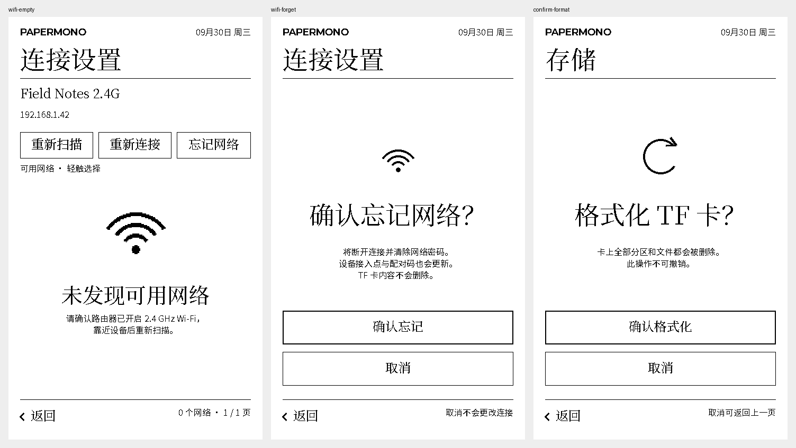

# Field Notes 设计一致性复核（2026-10-21）

本轮从 `f453559` 检查新增设备端 Wi-Fi 和 TF 格式化页面，与已确认的
[页面参考](../field-notes-expanded/preferences-reading-v1.png)、
[确认与异常参考](../field-notes-remaining/confirmations-errors-v1.png) 和
[原生实现预览](../field-notes-applied/) 对照。目标是让新流程延续原有设计系统。

## 修正内容

- **忘记网络确认：**原页面使用左对齐 24 px 标题、提前的图标和说明。现在与
  电源、蓝牙、恢复和格式化确认共用 `detail_confirmation`：96 px 动作图标，
  `y=352` 的居中 48 px 衬线标题，`y=434` 的居中说明，以及原有确认/取消区域。
- **Wi-Fi 空结果：**原页面只有较小的左对齐文字。现在使用同一图标系列的
  176 px Wi-Fi 焦点图标、40 px 状态标题和居中恢复说明。上方已保存网络与
  扫描操作仍可使用；因此这一空结果区域从 `y=306` 开始。
- **新增标题缺字：**旧标题字库不包含“存储”“格式化 TF 卡？”所需的
  储、化、存、式、格五个字，真实渲染出现方框。已补齐，并覆盖新的
  “确认忘记网络？”。状态字库也补齐“未发现可用网络”。字体检查现在从实际
  页头和确认标题提取文字验证，不只检查原来的一份固定字符清单。
- **键盘字号：**底排功能键统一使用 24 px 衬线字。44 px 字符键中的双字
  “空格”保留 16 px 标注，避免 48 px 文本被裁掉。原有按键位置、间隙、
  密码缓冲、提交和安全擦除逻辑没有改变。

## 实际画面

[修正前后对比](comparison.png) 上排为修正前，下排为修正后。
本目录 32 张独立页面均为当前生产 C 界面与真实 LVGL 生成的 480×800 I1
主机渲染，PNG 模式为 `1`。日期固定为 2026-09-30，网络、硬件和内容来自
合成夹具；这些画面不是设备照片或真实联网记录。

32 个状态包含 12 个 Wi-Fi/设置状态、首页与两页应用索引、书库、微信读书、
日历、待办、便签、信息、内容中心、遥控器、工具、系统、未格式化存储、电源，
以及休眠、关机、清除蓝牙配对、恢复默认和 TF 格式化确认。
内容页使用主机文件系统的初始空数据，未覆盖所有已填充内容的组合。

与修正前比较，24 张图片逐字节一致；系统和未格式化系统两张只在主机运行时间
数值处不同，布局相同；另外六张对应上述确认、空状态、键盘和缺字修正。
`manifest.json` 记录每张图片修正前后散列、差异区域、源文件及固件散列。
旧的 `field-notes-applied` 参考与验证记录保持原样。

## 检查结果

- `sh tests/host/run.sh` 通过，包括字体覆盖、34 个二值透明度图标、共享命中区域、
  Wi-Fi 输入模型与后端行为回归。
- `bash tests/preview/build.sh` 的 32 个状态通过。每个进程先调用真实 Wi-Fi
  事件函数和路由断言，再渲染页面；后端返回值仍为可注入的主机 stub。
- 预览增加 `LV_LABEL_LONG_CLIP` 文本与实际内容框的尺寸检查，防止键帽文字
  静默被裁。新增存储状态由主机 mount 错误注入触发真实存储模型，没有格式化磁盘。
- LVGL 主机堆配置为 65,536 bytes，报告的最高峰值为 45,808 bytes，分配器检查通过。
  I1 绘制缓冲和主机进程的其他内存不计入这个池；64 位主机结果不代表设备堆验收。
- 三种固件均从当前工作区重新构建成功，未出现编译警告；内部 DRAM 均通过
  项目 85% 预算门槛。默认候选位于忽略目录
  `artifacts/field-notes-ui-consistency-20261021/`，不纳入 Git。

| 配置 | 构建目录 | Flash bytes | 内部 DRAM bytes | 内部 DRAM |
| --- | --- | ---: | ---: | ---: |
| 默认 | `build-ui-consistency` | 4,548,868 | 337,816 | 84.64% |
| 局刷演示 | `build-ui-consistency-partial` | 4,423,908 | 312,136 | 78.21% |
| 驱动自检 | `build-ui-consistency-selftest` | 4,429,188 | 314,800 | 78.88% |

## 设备验证边界

本轮没有刷机、连接实际 Wi-Fi、写入凭据或格式化 TF 卡。此前设备端配网走查
不等于本次排版改动的屏幕与触摸验收。仍需在真机确认字形、图标、触摸命中、
墨水屏刷新和休眠恢复；主机交互断言不覆盖实体输入队列与射频行为。
